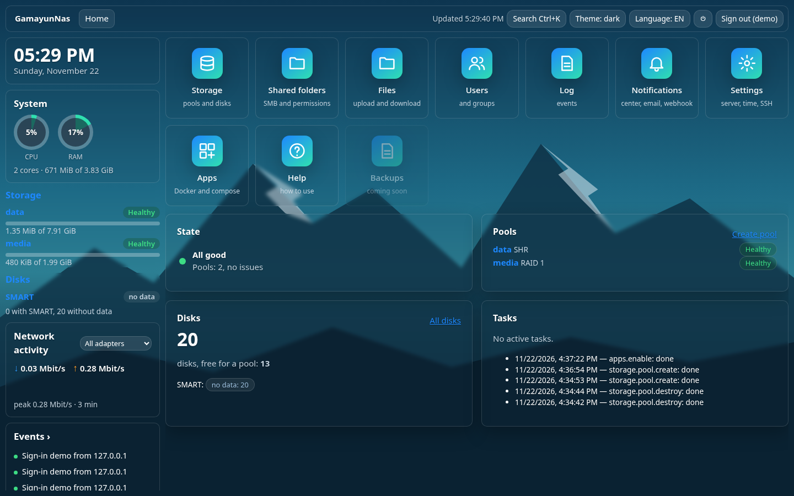
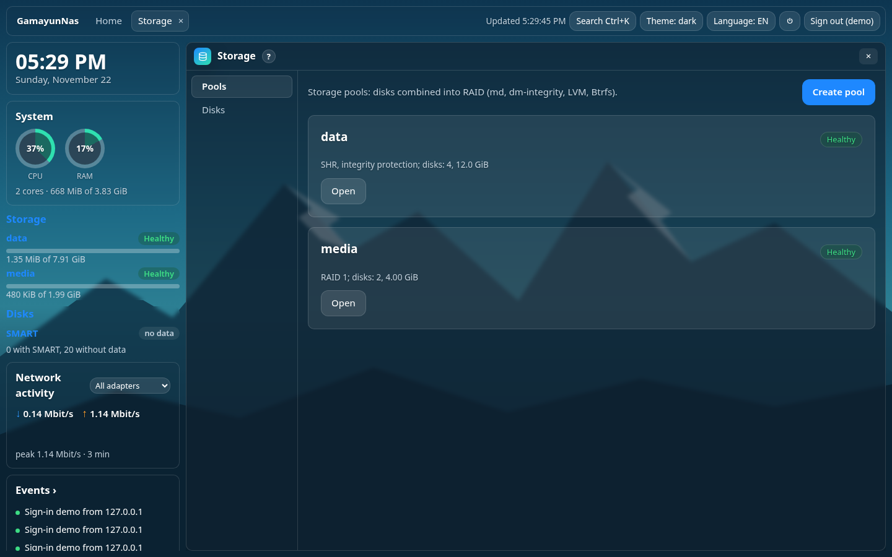
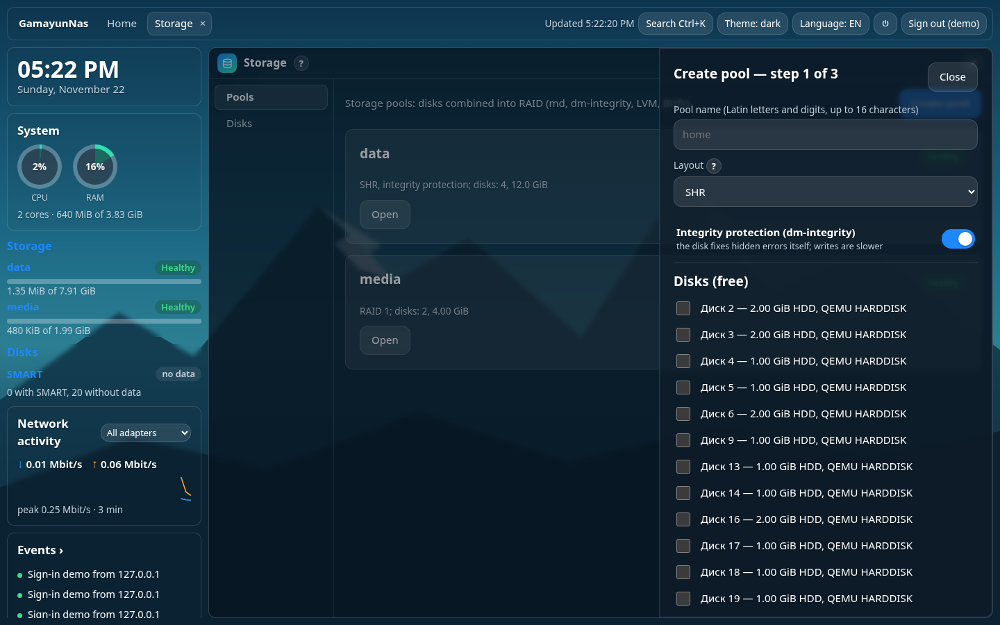
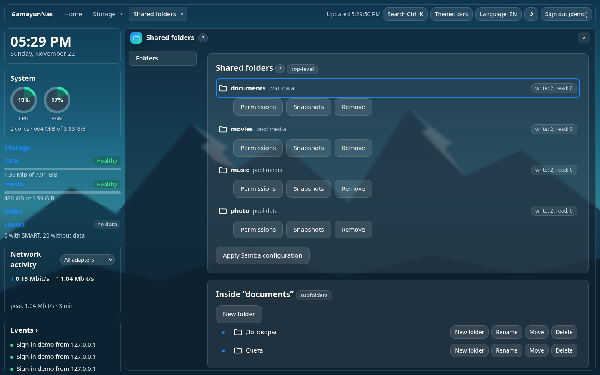
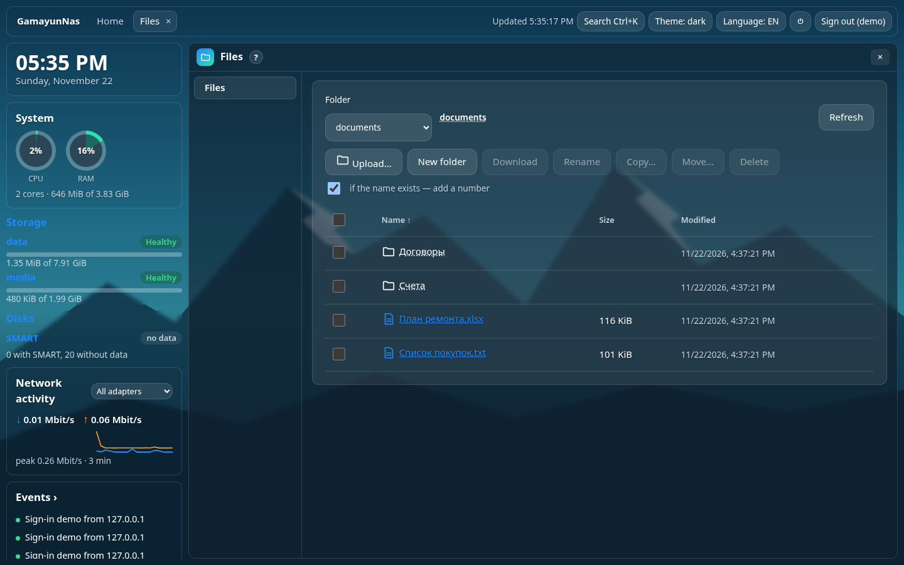
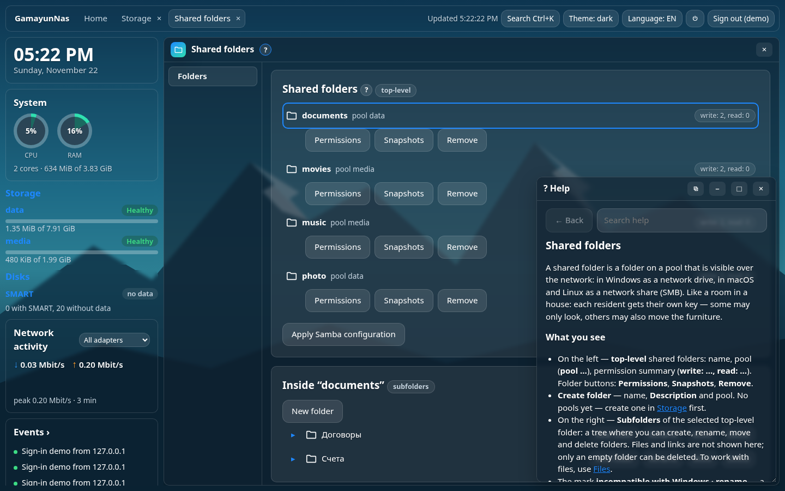

<h1 align="center">GamayunNas</h1>

<p align="center">
  A home and small-office NAS on plain Debian: disk pools, shared folders, users,
  snapshots and Docker applications — all managed from a browser.
</p>

<p align="center">
  <a href="README.md">Русский</a> ·
  <a href="docs/install.en.md">Installation</a> ·
  <a href="docs/build.en.md">Building from source</a> ·
  <a href="CHANGELOG.md">Changelog</a>
</p>

<p align="center">
  
  
  
</p>



> **Alpha.** The first public release, for early adopters. Keep important data in a backup on
> another device as well: RAID protects against a disk failure, not against deleted files or mistakes.

## Features

### Storage
- **Multi-disk pools:** Basic, JBOD, RAID 0, 1, 5, 6, 10, **SHR and SHR-2** — a flexible layout
  that uses disks of different sizes in full.
- **Data integrity** (dm-integrity): silent corruption on a disk is detected on read and repaired
  from another RAID copy.
- **Grow without rebuilding:** add a disk, replace with a larger one, convert RAID 1 → RAID 5,
  RAID 5 → RAID 6, SHR → SHR-2. Every action starts with a plan: what will happen and how much space you get.
- **Disk replacement**, including hot replacement while the old disk still works; an interrupted
  operation resumes after a reboot.
- **Pool protection:** when no redundancy is left, the pool switches to read-only so that the next
  failure does not destroy the data.
- **Pool import after reinstalling the OS:** pools are discovered on the disks and attached with
  their type and layout; settings are restored from the backup stored on the pool.
- **Disks:** roles, SMART, temperature with history, scheduled self-tests.
- **Scheduled data scrubbing.**

### Sharing
- **Shared folders** over SMB (Windows, macOS, Linux) with "no access / read / read-write"
  permissions for users and groups, nested folders.
- **Btrfs snapshots**, manual and scheduled, kept per hour, day, week and month; shown in Windows as
  **Previous Versions**. Restore creates a copy next to the original.
- **Web file manager:** upload, download (folders as zip), copy and move.
- **Users and groups**, SSH and SFTP login for those who are allowed.

### Applications (in development)
> The subsystem works but is still rough: no ready-made app catalog yet; the interface and workflows will change.

- **Docker on a pool:** apps from docker compose with a risk review (privileges, ports, folder
  access) and a dedicated account per app.
- **App web addresses** `https://<app>-<nas-name>.local/` via the bundled Caddy, signed in with the
  NAS administrator account.
- **Signed app catalog:** install and update with a restore point.

### Monitoring and maintenance
- **Event log** and **notification center**; delivery by e-mail (SMTP) and webhook, quiet hours.
- **Configuration backup** to a pool, over SFTP or as a file; restore in the first-run wizard.
- **Security:** HTTPS by default, custom certificate, password brute-force lockout, SSH protection
  (fail2ban); the SSH service stays off until you enable it.
- **Interface** in English and Russian, two layouts — "Tabs" and "Desktop"; built-in help with a
  **?** button in every window.

## Screenshots

| | |
|---|---|
|  |  |
|  |  |
|  | |

## Quick start

You need a machine with **Debian 13 (trixie) amd64**, a separate system disk and data disks.

```sh
# packages from the Releases page
sudo apt install ./gamayun-nas_*_amd64.deb
# optional — Docker applications
sudo apt install ./gamayun-nas-apps_*_amd64.deb
# first sign-in token
sudo cat /var/lib/gamayun-nas/setup-token
```

Open `https://<server-address>:8780/`, accept the self-signed certificate, enter the token and
complete the wizard: administrator, server name, time zone, first pool.

See the [installation guide](docs/install.en.md) for Debian preparation, upgrades, removal,
moving pools and troubleshooting.

## Architecture

```
Browser ──HTTPS──▶ gamayund (API, web UI, tasks, events)
                       │ unix socket, closed list of operations
                       ▼
                   gamayun-helper (root): mdadm, LVM, dm-integrity, Btrfs, Samba, SSH, SMART
```

- `gamayund` runs as a dedicated unprivileged account; it changes the system only through
  `gamayun-helper` and its closed list of operations.
- Pool stack: partitions → mdadm (RAID) → dm-integrity (optional) → LVM → Btrfs.
  Settings are kept in SQLite under `/var/lib/gamayun-nas`.
- Go (services) and Svelte 5 (UI); the web UI is embedded into the binary.

## Alpha limitations
- Debian 13 amd64 only. Upgrades are done by installing a new package, without A/B or automatic rollback.
- Hot spares are not supported.
- Server messages (errors, events, notifications) are in Russian; the interface and help are in English.
- Docker applications are in development: they work, but the interface and formats may change without compatibility.
- The app catalog is empty by default: sign your own catalog with `gamayun-catalog` (built from
  source) and point `catalog.keys_dir` at its public key.

## License

[Elastic License 2.0](LICENSE). Third-party components are under their own licenses
(in the packages: `/usr/share/doc/gamayun-nas*/`).
