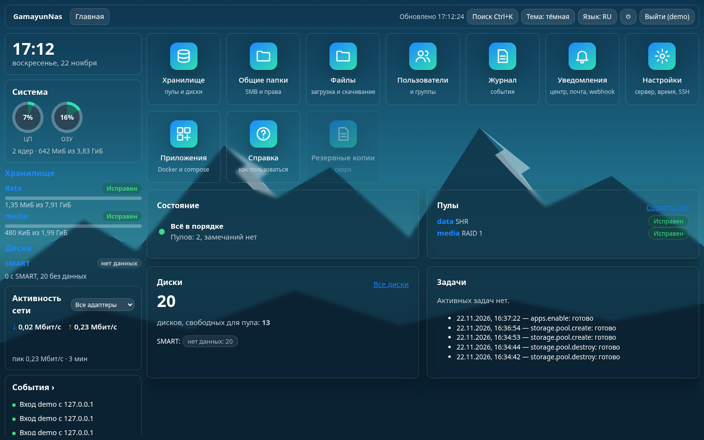
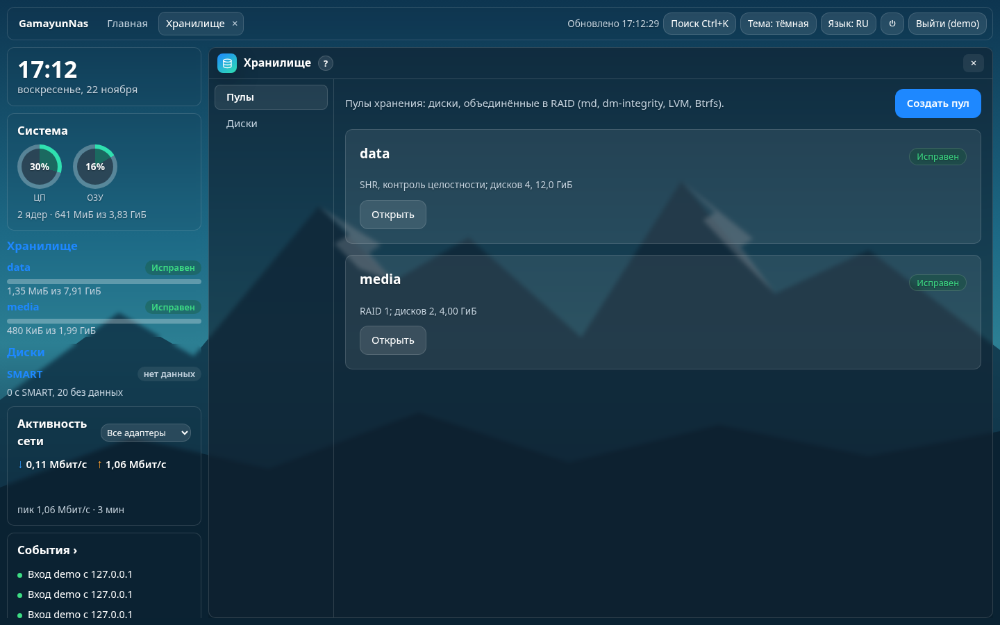
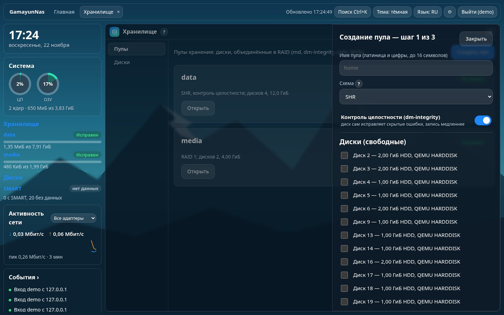
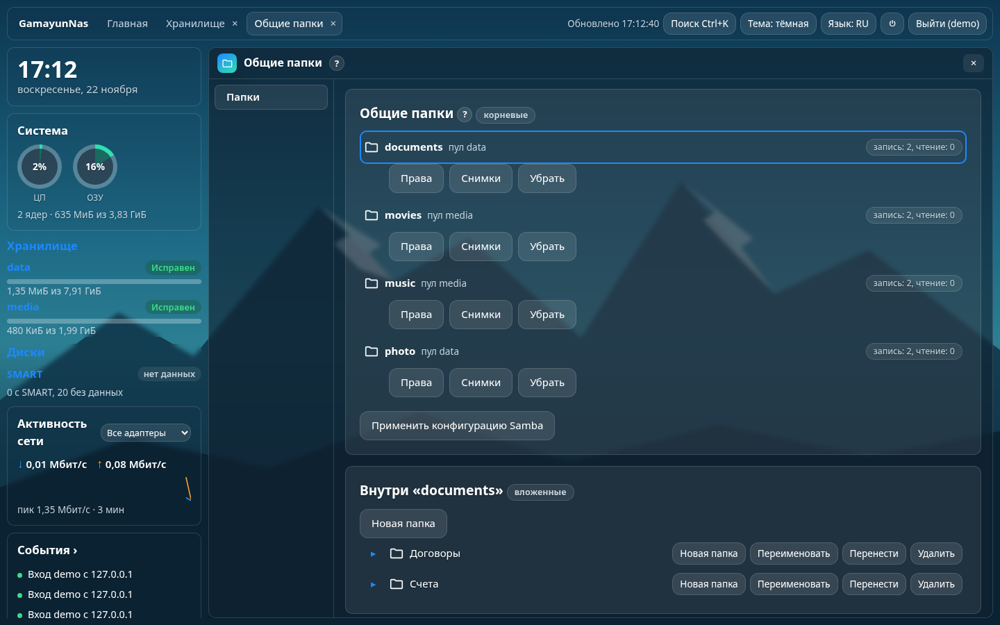
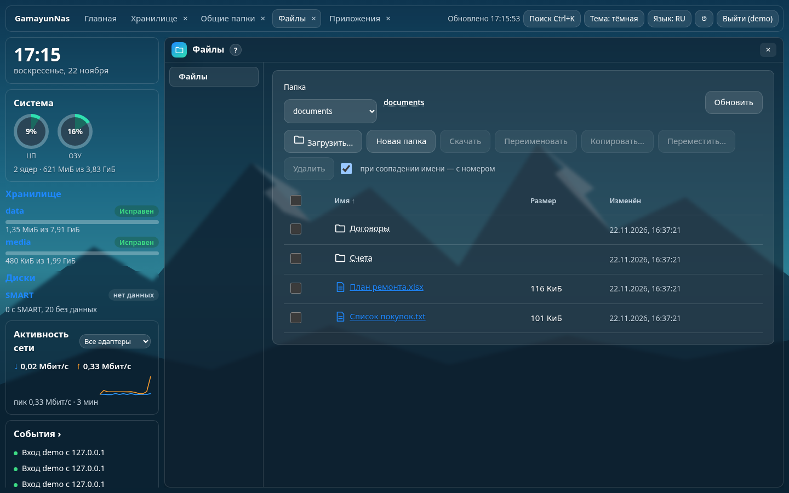
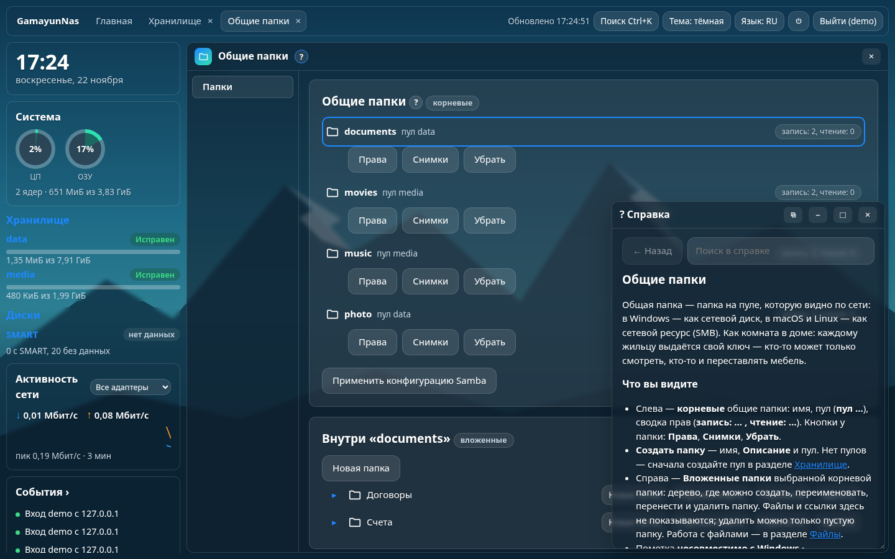

<h1 align="center">GamayunNas</h1>

<p align="center">
  Домашний и офисный NAS на обычном Debian: пулы дисков, общие папки, пользователи,
  снимки, приложения Docker — всё из браузера.
</p>

<p align="center">
  <a href="README.en.md">English</a> ·
  <a href="docs/install.md">Установка</a> ·
  <a href="docs/build.md">Сборка из исходников</a> ·
  <a href="CHANGELOG.md">Изменения</a>
</p>

<p align="center">
  
  
  
</p>



> **Alpha.** Первая публичная версия для тех, кто готов пробовать. Важные данные храните
> также в резервной копии на другом устройстве: RAID защищает от отказа диска, но не от
> удаления файлов и ошибок.

## Возможности

### Хранилище
- **Пулы из нескольких дисков:** Basic, JBOD, RAID 0, 1, 5, 6, 10, **SHR и SHR-2** — гибкая
  схема, которая полностью использует диски разного размера.
- **Контроль целостности данных** (dm-integrity): тихая порча данных на диске обнаруживается
  при чтении и исправляется с другой копии RAID.
- **Расширение без пересоздания:** добавление диска, замена на больший, переходы RAID 1 → RAID 5,
  RAID 5 → RAID 6, SHR → SHR-2. Перед каждым действием — план: что произойдёт и сколько будет места.
- **Замена диска**, в том числе «горячая» — пока старый ещё работает; прерванная операция
  продолжается после перезагрузки.
- **Защита пула:** когда запас избыточности исчерпан, пул переходит в «только чтение», чтобы
  следующий отказ не уничтожил данные.
- **Подхват пулов после переустановки системы:** пулы находятся на дисках и подключаются
  с прежним типом и составом, настройки восстанавливаются из копии на пуле.
- **Диски:** роли, SMART, температура и её история, самотесты по расписанию.
- **Проверка данных пула** (scrub) по расписанию.

### Общий доступ
- **Общие папки** по SMB (Windows, macOS, Linux) с правами «нет доступа / чтение / чтение и запись»
  для пользователей и групп, вложенные папки.
- **Снимки Btrfs** вручную и по расписанию с хранением по часам, дням, неделям и месяцам;
  в Windows видны как **Предыдущие версии**. Восстановление — копией рядом с оригиналом.
- **Файловый менеджер в браузере:** загрузка, скачивание (папка — zip), копирование и перенос.
- **Пользователи и группы**, вход по SSH и SFTP для тех, кому он разрешён.

### Приложения (в разработке)
> Подсистема работает, но пока сырая: без готового каталога приложений, интерфейс и сценарии будут меняться.

- **Docker на пуле:** приложения из docker compose с проверкой рисков (привилегии, порты,
  доступ к папкам) и отдельной учётной записью для каждого приложения.
- **Веб-адреса приложений** `https://<приложение>-<имя-NAS>.local/` через встроенный Caddy,
  вход — по учётной записи администратора NAS.
- **Каталог приложений** с цифровой подписью: установка и обновление с точкой восстановления.

### Наблюдение и обслуживание
- **Журнал событий** и **центр уведомлений**; доставка на почту (SMTP) и webhook, режим тишины.
- **Резервная копия настроек** на пул, по SFTP или файлом; восстановление — в мастере первого запуска.
- **Безопасность:** HTTPS по умолчанию, свой сертификат, блокировка перебора паролей, защита SSH
  (fail2ban); служба SSH выключена, пока её не включат.
- **Интерфейс** на русском и английском, два стиля — «Вкладки» и «Рабочий стол»; встроенная
  справка с кнопкой **?** в каждом окне.

## Скриншоты

| | |
|---|---|
|  |  |
|  |  |
|  | |

## Быстрый старт

Нужен компьютер с **Debian 13 (trixie) amd64**, отдельный системный диск и диски для данных.

```sh
# пакеты — из раздела Releases
sudo apt install ./gamayun-nas_*_amd64.deb
# необязательно — приложения Docker
sudo apt install ./gamayun-nas-apps_*_amd64.deb
# токен первого входа
sudo cat /var/lib/gamayun-nas/setup-token
```

Откройте `https://<адрес-сервера>:8780/`, примите самоподписанный сертификат, введите токен
и пройдите мастер: администратор, имя сервера, часовой пояс, первый пул.

Подробно — в [инструкции по установке](docs/install.md): подготовка Debian, обновление, удаление,
перенос пулов, диагностика.

## Устройство

```
Браузер ──HTTPS──▶ gamayund (API, веб-интерфейс, задачи, события)
                       │ unix-сокет, закрытый список операций
                       ▼
                   gamayun-helper (root): mdadm, LVM, dm-integrity, Btrfs, Samba, SSH, SMART
```

- `gamayund` работает от отдельной учётной записи без прав root; систему он меняет только
  через `gamayun-helper` по закрытому списку операций.
- Пул: разделы → mdadm (RAID) → dm-integrity (по выбору) → LVM → Btrfs.
  Настройки — SQLite в `/var/lib/gamayun-nas`.
- Go (службы) и Svelte 5 (интерфейс); веб встроен в бинарник.

## Ограничения alpha
- Только Debian 13 amd64. Обновление — установкой нового пакета, без A/B и автоматического отката.
- Горячий резерв (hot spare) не поддерживается.
- Сообщения сервера (ошибки, события, уведомления) — только на русском, интерфейс и справка — на двух языках.
- Приложения Docker — в разработке: работают, но интерфейс и формат могут измениться без совместимости.
- Каталог приложений по умолчанию пуст: свой каталог подписывается инструментом
  `gamayun-catalog` (собирается из исходников), открытый ключ указывается в `catalog.keys_dir`.

## Лицензия

[Elastic License 2.0](LICENSE). Сторонние компоненты — под своими лицензиями
(в пакетах: `/usr/share/doc/gamayun-nas*/`).
